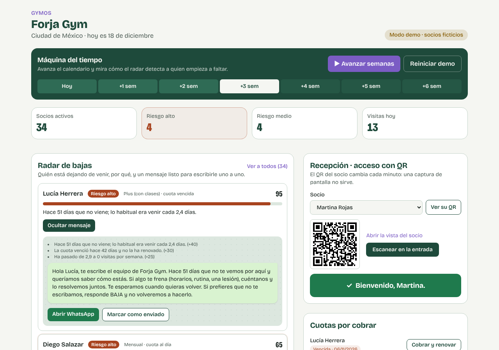

# GymOS

Fábrica · GymOS: panel para gimnasios pequeños de Latinoamérica. QR de acceso que cambia cada minuto, cuotas,
**radar de bajas** que detecta al socio que se está yendo y prepara un mensaje de WhatsApp uno a uno, rutinas y
ranking por constancia. Funciona **sin ninguna clave** (modo demo con 34 socios ficticios); Mercado Pago, WhatsApp
Cloud API e IA son opcionales.



## Probarlo

```bash
npm install
npm run dev     # http://localhost:3000
npm test        # 60 tests
```

- **Máquina del tiempo**: avanza la demo semana a semana y mira cómo el radar detecta a quien empieza a faltar.
- **Recepción**: elige un socio, "Ver su QR" y "Escanear en la entrada" (verde si la cuota está al día, rojo si no).
- **Vista del socio**: `/socio/martina-rojas`, el QR que se renueva solo.

## Cómo funciona el radar de bajas

Para cada socio compara su ritmo reciente (últimas 3 semanas) con lo habitual (las 8 semanas anteriores) y suma
puntos por señales que se pueden explicar: días sin venir frente a su frecuencia, caída de ritmo, cuota vencida,
renovación cercana con menos asistencia y altas que nunca vinieron. Si no hay historial suficiente dice
"sin datos": no inventa. Pesos y umbrales en [`src/gimnasio/config.ts`](src/gimnasio/config.ts).

## Integraciones opcionales

Ver [`.env.example`](.env.example). En cuanto activas una, el panel exige `GYMOS_TOKEN`.

| Integración | Qué hace | Variables |
|---|---|---|
| Mercado Pago | Enlace de pago, suscripción mensual y webhook firmado que renueva la cuota | `MERCADOPAGO_ACCESS_TOKEN`, `MERCADOPAGO_WEBHOOK_SECRET` |
| WhatsApp Cloud API | Envía una plantilla aprobada a un socio, tras confirmarlo una persona | `WHATSAPP_TOKEN`, `WHATSAPP_PHONE_NUMBER_ID`, `WHATSAPP_PLANTILLA_RETENCION` |
| IA (compatible con OpenAI) | Rutinas propuestas por un modelo, validadas contra el catálogo | `IA_API_KEY`, `IA_BASE_URL`, `IA_MODELO` |

Todas probadas solo con respuestas simuladas por ahora (ver [`AUDITORIA.md`](AUDITORIA.md)).

## Guion del vídeo (60 s)

| Tiempo | Pantalla | Voz en off |
|---|---|---|
| 0-5 s | Panel de Forja Gym | "La mayoría de los socios de un gimnasio se van en silencio." |
| 5-15 s | Vista del socio en el móvil, QR con la cuenta atrás; recepción escanea → verde | "Entran con un QR que cambia cada minuto: una captura no sirve." |
| 15-20 s | Escanear a Lucía → rojo "tu cuota está vencida" | "Si la cuota venció, no pasa." |
| 20-40 s | Pulsar "Avanzar semanas": las fugas se encienden en rojo una a una | "GymOS mira cuánto venía cada socio y detecta al que empieza a faltar, semanas antes de que se dé de baja." |
| 40-50 s | "Preparar WhatsApp" en Valentina → mensaje personalizado → "Abrir WhatsApp" | "Y te deja el mensaje listo para escribirle, uno a uno, con el motivo real." |
| 50-60 s | Ranking del mes y una rutina generada | "Ranking por constancia y rutinas en un segundo. GymOS, de la Fábrica." |

## Arquitectura

Ver [`CLAUDE.md`](CLAUDE.md) y [`ALCANCE.md`](ALCANCE.md). Motor puro en `src/gimnasio/` (sin UI ni red, "hoy"
siempre por parámetro), integraciones en `src/integraciones/`, interfaz y rutas API en `src/app/`.
